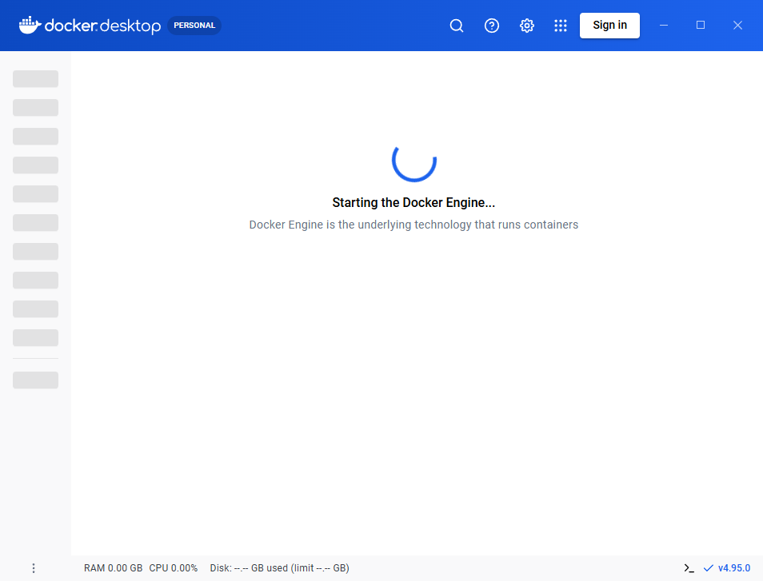
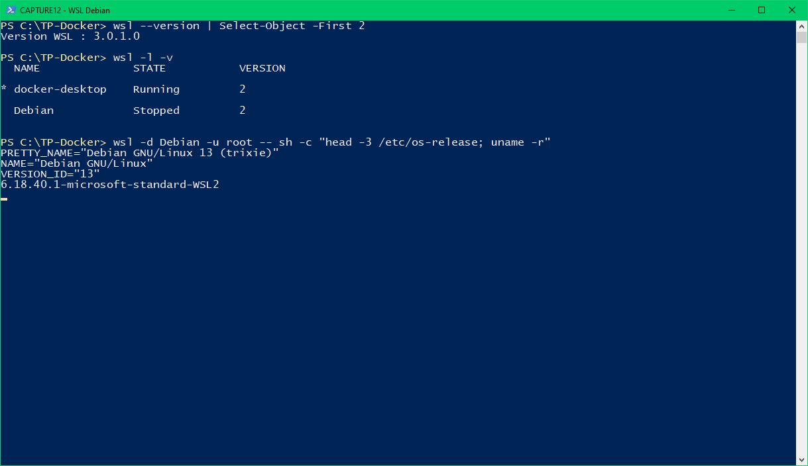

# CM-TD-TP SAE5012 — Partie 1 : journal d'installation (WSL 2 + Docker Desktop)

Machine utilisée : PC personnel — Windows 10 Famille 22H2 (build 19045.6466), AMD 3020e (2 cœurs), 14 Go de RAM, SSD avec ~8 Go libres au départ.

## Étape 0 — Vérification des prérequis

| Vérification | Commande (PowerShell) | Résultat |
|---|---|---|
| Version de Windows | `(Get-ItemProperty 'HKLM:\SOFTWARE\Microsoft\Windows NT\CurrentVersion').DisplayVersion` | 22H2, build 19045 (WSL 2 demande ≥ 19041) |
| Virtualisation activée dans le BIOS | `Get-CimInstance Win32_Processor \| Select VirtualizationFirmwareEnabled` | `True` |
| WSL déjà présent ? | `wsl --version` | WSL 3.0.1.0, noyau 6.18 installé… |
| … mais composant Windows actif ? | `wsl -l -v` | Erreur `WSL_E_WSL_OPTIONAL_COMPONENT_REQUIRED` → le composant « Sous-système Windows pour Linux » n'est pas activé |
| Hyper-V disponible ? | — | **Non** : Hyper-V n'existe pas sur Windows 10/11 **Famille** (seulement Pro/Entreprise/Éducation). Docker Desktop utilisera donc le moteur **WSL 2**, qui est aussi le moteur recommandé par Docker. |

## Étape 1 — Activer WSL et la plateforme de machine virtuelle

Il faut deux fonctionnalités Windows :
- **Microsoft-Windows-Subsystem-Linux** (WSL) ;
- **VirtualMachinePlatform** (nécessaire à WSL 2, qui fait tourner un vrai noyau Linux dans une machine virtuelle légère).

### Les différentes manières (demandé par le sujet)

1. **Une seule commande** (la plus simple, PowerShell en administrateur) :
   ```powershell
   wsl --install            # active tout + installe Ubuntu par défaut
   wsl --install -d Debian  # idem en choisissant Debian
   ```
2. **DISM** (méthode « manuelle » de la doc Microsoft — **méthode utilisée ici**), PowerShell en administrateur :
   ```powershell
   dism.exe /online /enable-feature /featurename:Microsoft-Windows-Subsystem-Linux /all /norestart
   dism.exe /online /enable-feature /featurename:VirtualMachinePlatform /all /norestart
   ```
   Résultat pour chacune : `L'opération a réussi.`
3. **Cmdlet PowerShell** équivalent :
   ```powershell
   Enable-WindowsOptionalFeature -Online -FeatureName Microsoft-Windows-Subsystem-Linux -NoRestart
   Enable-WindowsOptionalFeature -Online -FeatureName VirtualMachinePlatform -NoRestart
   ```
4. **Interface graphique** : Panneau de configuration → Programmes → *Activer ou désactiver des fonctionnalités Windows* → cocher « Sous-système Windows pour Linux » et « Plateforme de machine virtuelle » (et « Hyper-V » sur une édition Pro).

> Hyper-V sur une édition Pro : `dism.exe /online /enable-feature /featurename:Microsoft-Hyper-V /all` ou la case « Hyper-V » de l'interface graphique. Non applicable ici (Windows Famille).

Un **redémarrage** est obligatoire après l'activation.

## Étape 2 — Installer Docker Desktop

Deux manières :
1. **Graphique** : télécharger l'installeur sur https://www.docker.com/products/docker-desktop/ puis lancer `Docker Desktop Installer.exe` en cochant « Use WSL 2 instead of Hyper-V ».
2. **En ligne de commande avec winget** (gestionnaire de paquets de Windows) — **méthode utilisée ici** :
   ```powershell
   winget install --id Docker.DockerDesktop -e --accept-package-agreements --accept-source-agreements `
     --silent --override "install --quiet --accept-license --backend=wsl-2"
   ```
   Résultat :
   ```
   Trouvé Docker Desktop [Docker.DockerDesktop] Version 4.95.0
   Téléchargement en cours https://desktop.docker.com/win/main/amd64/242831/Docker%20Desktop%20Installer.exe
   Le code de hachage de l'installation a été vérifié avec succès
   Le programme d'installation demande à s'exécuter en tant qu'administrateur. Attendez-vous à une invite.
   Installé correctement
   ```

Vérifications après installation :
```powershell
net localgroup docker-users      # l'utilisateur « Azur » est bien membre du groupe docker-users
docker --version                 # Docker version 29.8.2, build 7fc2dff
```

Espace disque consommé par Docker Desktop : ~3,3 Go (8,3 Go → 5,0 Go libres).

## Étape 3 — Limiter les ressources de WSL 2 (PC modeste)

Fichier `C:\Users\Azur\.wslconfig` créé pour éviter que WSL 2 / Docker ne prennent toute la mémoire et le disque :
```ini
[wsl2]
memory=4GB        # RAM maximale donnée à la VM WSL 2
processors=2
swap=1GB          # fichier d'échange réduit (par défaut ~25 % de la RAM, stocké sur C:)

[experimental]
autoMemoryReclaim=gradual   # rend la mémoire inutilisée à Windows
```
Après modification : `wsl --shutdown` pour qu'elle soit prise en compte.

> Remarque : une première version contenait aussi `sparseVhd=true` (disque virtuel qui se réduit automatiquement). WSL l'a refusée au démarrage : *« La prise en charge des VHD espacés est actuellement désactivée en raison d'un risque potentiel de corruption des données »*. L'option a donc été retirée.

## Étape 4 — Redémarrage et premier lancement de Docker Desktop

1. Redémarrage de Windows (obligatoire pour activer WSL et la plateforme de machine virtuelle).
2. Lancement de **Docker Desktop** depuis le menu Démarrer → acceptation des conditions d'utilisation → « Continue without signing in » (pas besoin de compte Docker Hub pour télécharger des images publiques).
3. Écran *« Starting the Docker Engine… »* puis tableau de bord (version affichée en bas à droite : v4.95.0, plan **Personal**).



Vérifications :
```powershell
wsl -l -v
```
```
  NAME              STATE           VERSION
* docker-desktop    Running         2
```
→ Docker Desktop a créé sa propre distribution WSL 2, `docker-desktop`, dans laquelle tourne le démon Docker.

```powershell
docker version
```
```
Client:
 Version:           29.8.2
 OS/Arch:           windows/amd64
 Context:           desktop-linux
Server: Docker Desktop 4.95.0 (242831)
 Engine:
  Version:          29.8.2
  OS/Arch:          linux/amd64
 containerd:
  Version:          v2.3.6
 runc:
  Version:          1.5.1
```
→ On voit bien l'architecture client/serveur : le **client** est un programme Windows, le **serveur** (moteur) est un programme **Linux** qui tourne dans WSL 2, et il s'appuie sur **containerd** et **runc**.

## Étape 5 — Installer la distribution Debian dans WSL

```powershell
wsl --install -d Debian --no-launch
```
```
Téléchargement : Debian GNU/Linux
Installation : Debian GNU/Linux
La distribution a été installée. Il peut être lancé via 'wsl.exe -d Debian'
```
```powershell
wsl -l -v
```
```
  NAME              STATE           VERSION
* docker-desktop    Running         2
  Debian            Stopped         2
```
Test dans Debian :
```powershell
wsl -d Debian -u root -- sh -c "cat /etc/os-release | head -3; uname -r"
```
```
PRETTY_NAME="Debian GNU/Linux 13 (trixie)"
NAME="Debian GNU/Linux"
VERSION_ID="13"
6.18.40.1-microsoft-standard-WSL2
```
→ Debian 13 tourne bien avec le **noyau Linux de Microsoft pour WSL 2**.



Autres manières d'installer une distribution : `wsl --list --online` (liste des distributions disponibles) puis `wsl --install -d <nom>`, ou via le **Microsoft Store** (rechercher « Debian »). Au premier lancement interactif (`wsl -d Debian`), Debian demande de créer un nom d'utilisateur et un mot de passe Linux.

Option : dans Docker Desktop → *Settings → Resources → WSL integration*, on peut cocher Debian pour utiliser la commande `docker` directement depuis le terminal Debian.

## Bilan disque

| Moment | Espace libre sur C: |
|---|---|
| Avant installation | 8,3 Go |
| Après installation de Docker Desktop | 5,0 Go |
| Après premier démarrage du moteur (création de `docker_data.vhdx`, ~1,6 Go) | 2,5 Go |
| Après installation de Debian (~330 Mo) | 2,2 Go |

Le disque virtuel de Docker (`%LOCALAPPDATA%\Docker\wsl\disk\docker_data.vhdx`) grossit avec les images et ne se réduit pas tout seul : penser à `docker system prune` et, si besoin, *Troubleshoot → Clean / Purge data* dans Docker Desktop.
