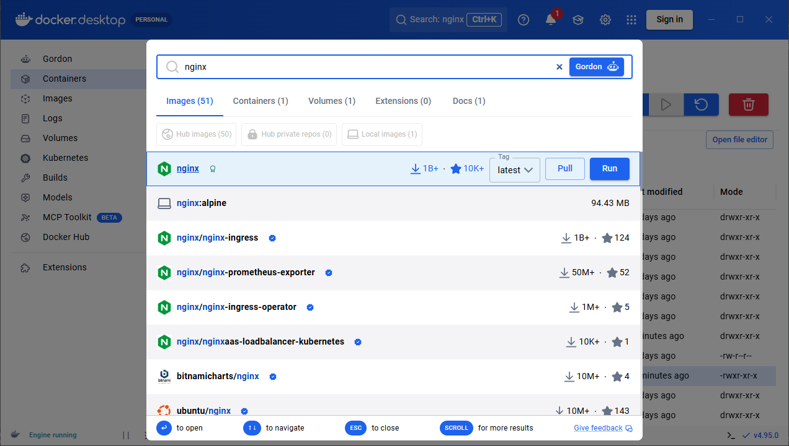
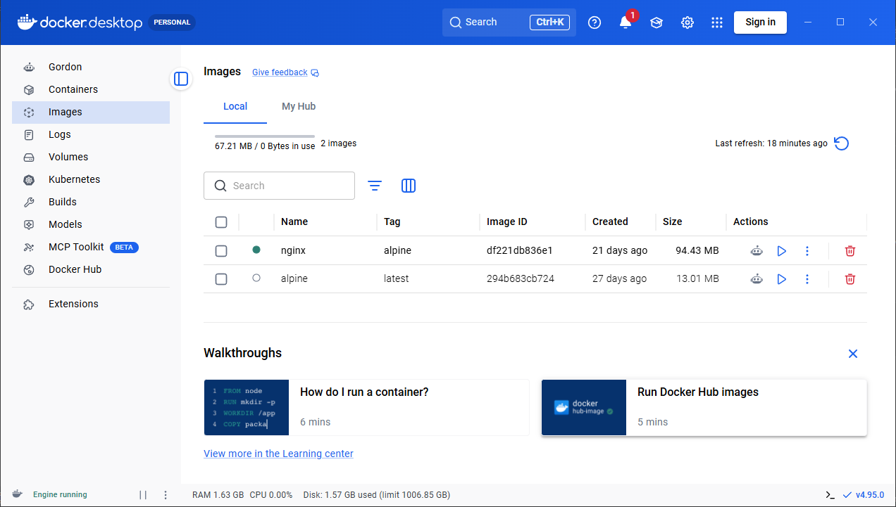
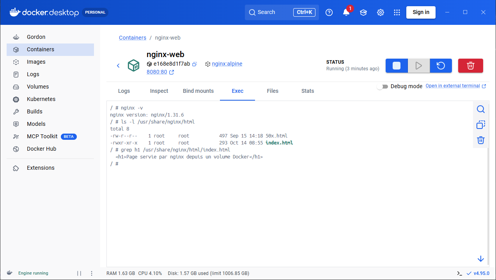
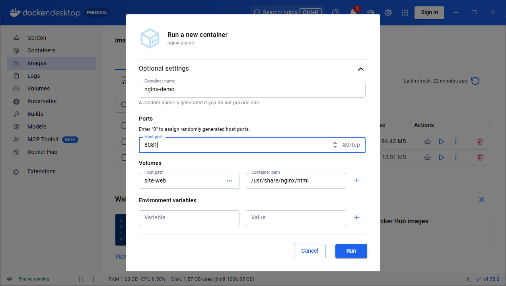
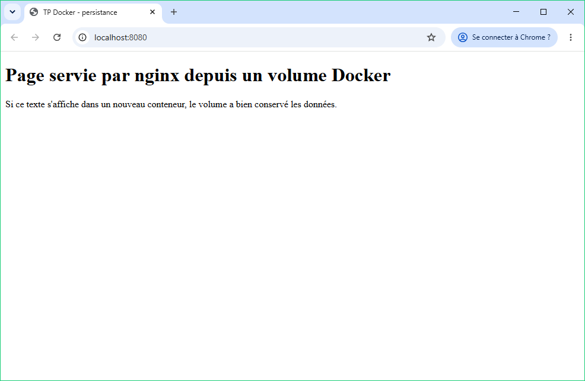
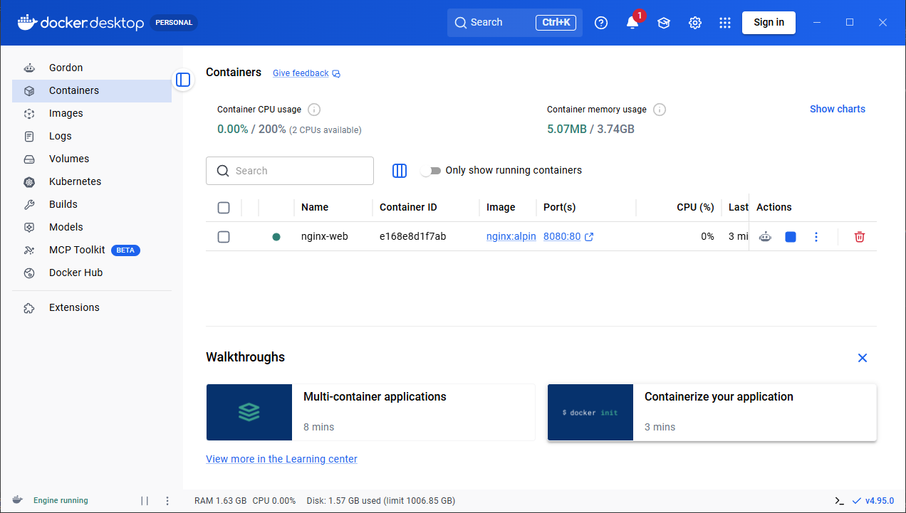
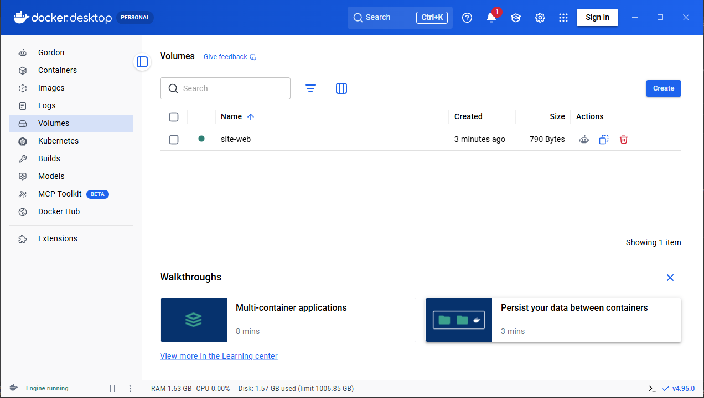
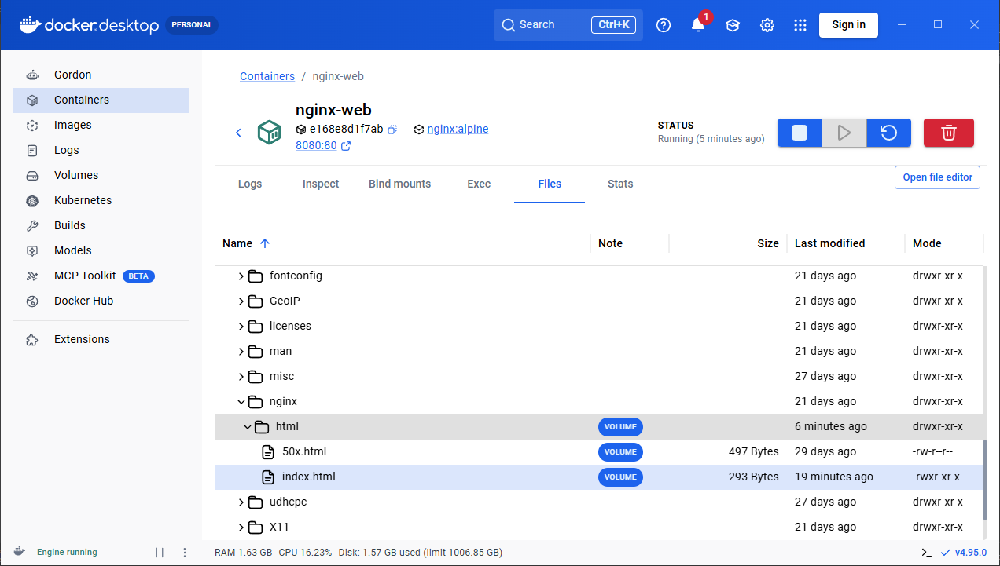

# CM-TD-TP SAE5012 — Partie 1 : mise en pratique (nginx, commandes, volumes)

Environnement : Windows 10 Famille, Docker Desktop 4.95.0 (moteur 29.8.2) sur WSL 2. Commandes tapées dans **PowerShell**. Les sorties ci-dessous sont les sorties réelles (journal brut complet : `_sorties_tp1.txt`).

Choix d'images : **`nginx:alpine`** (nginx sur base Alpine Linux, 94 Mo, environ deux fois plus léger que `nginx:latest` qui est sur base Debian) et **`alpine`** (13 Mo), pour économiser le disque. Le fonctionnement de nginx est identique.

Pour chaque action, on indique l'équivalent dans **Docker Desktop** (interface graphique).

---

## 1. Vérifier la version de Docker
```powershell
docker --version
docker version
```
```
Docker version 29.8.2, build 7fc2dff
Client 29.8.2 / Serveur 29.8.2
```
**Desktop** : numéro de version en bas à droite de la fenêtre (v4.95.0), ou *Paramètres (roue dentée) → About / À propos*.

## 2. Lister les images locales
```powershell
docker images        # ou : docker image ls
```
Au départ :
```
IMAGE   ID             DISK USAGE   CONTENT SIZE   EXTRA
```
(liste vide)
**Desktop** : onglet **Images** du menu de gauche.

## 3. Obtenir une image
```powershell
docker pull nginx:alpine
docker pull alpine
```
```
alpine: Pulling from library/nginx
e72112c14215: Pull complete
...
Digest: sha256:df221db836e1754089190208cee7eeda94f233197056426eda74a43ab1abeac2
Status: Downloaded newer image for nginx:alpine
docker.io/library/nginx:alpine
```
On remarque que l'image est téléchargée **couche par couche** depuis le registre Docker Hub (`docker.io/library/...`).
```powershell
docker images
```
```
IMAGE           ID             DISK USAGE   CONTENT SIZE   EXTRA
alpine:latest   294b683cb724         13MB         3.94MB
nginx:alpine    df221db836e1       94.4MB         27.2MB
```
Sans tag (`docker pull alpine`), Docker prend le tag `latest`.
**Desktop** : barre de recherche en haut (*Search*) → taper « nginx » → choisir le tag → **Pull**.





## 4. Créer un conteneur à partir d'une image
`docker create` crée le conteneur **sans le démarrer** :
```powershell
docker create --name nginx-cree -p 8081:80 nginx:alpine
docker ps -a
```
```
0c8d8fffb65b547051ddc9afdc7ab6dbe29ccb062dfa5abfa2d48a3aa4eeb450
CONTAINER ID   IMAGE          COMMAND                  CREATED        STATUS    PORTS     NAMES
0c8d8fffb65b   nginx:alpine   "/docker-entrypoint.…"   1 second ago   Created             nginx-cree
```
Statut **Created** : le conteneur existe mais ne tourne pas.

## 5. `docker run` avec un terminal interactif
`docker run` = `docker create` + `docker start`. Les options **`-i`** (garder l'entrée standard ouverte) et **`-t`** (allouer un pseudo-terminal) donnent un shell dans le conteneur :
```powershell
docker run -it --name alpine-it alpine sh
```
Dans le shell du conteneur :
```
/ # cat /etc/alpine-release
3.24.2
/ # hostname
0ea4671560b9
/ # whoami
root
/ # ls /
bin  dev  etc  home  lib  media  mnt  opt  proc  root  run  sbin  srv  sys  tmp  usr  var
/ # exit
```
On est dans un mini-système Alpine 3.24, en tant que `root`, et le nom de machine est l'identifiant du conteneur. `exit` quitte le shell, ce qui **arrête** le conteneur (son processus principal est terminé).
**Desktop** : *Images* → bouton ▶ **Run** sur l'image ; puis, dans *Containers*, ouvrir le conteneur → onglet **Exec** pour avoir un terminal.



## 6. Faire fonctionner nginx et le rendre accessible
```powershell
docker run -d --name nginx-web -p 8080:80 nginx:alpine
```
- `-d` (*detached*) : en arrière-plan ;
- `-p 8080:80` : le port 8080 de Windows est redirigé vers le port 80 du conteneur.

Test (dans un navigateur : http://localhost:8080, ou en ligne de commande) :
```powershell
curl.exe -s http://localhost:8080
```
```html
<!DOCTYPE html>
<html>
<head>
<title>Welcome to nginx!</title>
...
<h1>Welcome to nginx!</h1>
<p>If you see this page, nginx is successfully installed and working.
```
**Desktop** : *Images* → nginx → **Run** → *Optional settings* : nom du conteneur et *Host port* = 8080 → **Run**. Dans *Containers*, cliquer sur le lien **8080:80** ouvre la page dans le navigateur.





## 7. Lister les conteneurs en cours d'exécution
```powershell
docker ps
```
```
CONTAINER ID   IMAGE          COMMAND                  CREATED         STATUS        PORTS                                     NAMES
9b7b0d9bb3c7   nginx:alpine   "/docker-entrypoint.…"   3 seconds ago   Up 1 second   0.0.0.0:8080->80/tcp, [::]:8080->80/tcp   nginx-web
```
**Desktop** : onglet **Containers** (pastille verte = en cours ; case *Only show running containers*).



## 8. Lister les conteneurs arrêtés
```powershell
docker ps -a                                              # tous les conteneurs
docker ps -a --filter status=exited --filter status=created   # seulement ceux qui ne tournent pas
```
```
CONTAINER ID   IMAGE          COMMAND                  CREATED          STATUS                     PORTS     NAMES
ea55bf06ce37   alpine         "sh"                     6 seconds ago    Exited (2) 4 seconds ago             alpine-it
0c8d8fffb65b   nginx:alpine   "/docker-entrypoint.…"   18 seconds ago   Created                              nginx-cree
```
**Desktop** : onglet *Containers*, décocher *Only show running containers* (les conteneurs arrêtés sont en gris).

## 9. Arrêter un conteneur
```powershell
docker stop nginx-web
docker ps -a --filter name=nginx-web
curl.exe -s -o NUL -w "code HTTP: %{http_code}\n" http://localhost:8080
```
```
nginx-web
CONTAINER ID   IMAGE          ...   STATUS                     PORTS     NAMES
9b7b0d9bb3c7   nginx:alpine   ...   Exited (0) 2 seconds ago             nginx-web
code HTTP: 000
```
Le conteneur est arrêté (`Exited (0)` = arrêt normal) et le site ne répond plus (`000` = pas de réponse).
**Desktop** : bouton ■ **Stop** sur la ligne du conteneur.

## 10. Démarrer un conteneur
```powershell
docker start nginx-web
docker ps --filter name=nginx-web
curl.exe -s -o NUL -w "code HTTP: %{http_code}\n" http://localhost:8080
```
```
nginx-web
CONTAINER ID   IMAGE          ...   STATUS         PORTS                                     NAMES
9b7b0d9bb3c7   nginx:alpine   ...   Up 2 seconds   0.0.0.0:8080->80/tcp, [::]:8080->80/tcp   nginx-web
code HTTP: 200
```
Le **même** conteneur redémarre avec sa configuration (port 8080) : le site répond (`200 OK`).
**Desktop** : bouton ▶ **Start**.

## 11. Supprimer le conteneur
```powershell
docker rm nginx-web
```
```
Error response from daemon: cannot remove container "nginx-web": container is running: stop the container before removing or force remove
```
Un conteneur en marche ne peut pas être supprimé : il faut l'arrêter d'abord, ou forcer avec `-f`.
```powershell
docker stop nginx-web
docker rm nginx-web          # ou directement : docker rm -f nginx-web
```
```
nginx-web
nginx-web
```
**Desktop** : icône 🗑 **Delete** sur la ligne du conteneur.

## 12. Créer un volume et le monter sur un nouveau conteneur
```powershell
docker volume create site-web
docker volume ls
docker volume inspect site-web
```
```
site-web
DRIVER    VOLUME NAME
local     site-web
[
    {
        "CreatedAt": "2026-10-14T08:57:37Z",
        "Driver": "local",
        "Mountpoint": "/var/lib/docker/volumes/site-web/_data",
        "Name": "site-web",
        "Scope": "local"
    }
]
```
Le volume est stocké par Docker dans `/var/lib/docker/volumes/site-web/_data` (à l'intérieur de la machine WSL 2 de Docker Desktop).

Montage sur le dossier des pages web de nginx :
```powershell
docker run -d --name nginx-vol1 -p 8080:80 -v site-web:/usr/share/nginx/html nginx:alpine
```
Comme le volume était vide, Docker l'a rempli avec le contenu de l'image (la page « Welcome to nginx! »).
**Desktop** : onglet **Volumes** → **Create** ; puis au lancement d'un conteneur, *Optional settings → Volumes* : *Host path* = `site-web`, *Container path* = `/usr/share/nginx/html`.



## 13. Copier un fichier `index.html` dans le conteneur
Fichier créé sur le PC : `tp1-fichiers/index.html` (une page « Page servie par nginx depuis un volume Docker »).
```powershell
docker cp tp1-fichiers\index.html nginx-vol1:/usr/share/nginx/html/index.html
curl.exe -s http://localhost:8080
docker exec nginx-vol1 ls -l /usr/share/nginx/html
```
```html
<title>TP Docker - persistance</title>
...
<h1>Page servie par nginx depuis un volume Docker</h1>
```
```
-rw-r--r--    1 root     root           497 Sep 15 14:18 50x.html
-rwxr-xr-x    1 root     root           293 Oct 14 08:55 index.html
```
La nouvelle page remplace celle de nginx. `docker exec` exécute une commande dans un conteneur qui tourne déjà.
**Desktop** : conteneur → onglet **Files** (explorateur des fichiers du conteneur, avec import/édition).



## 14. Persistance : supprimer le conteneur et en relancer un autre sur le même volume
```powershell
docker rm -f nginx-vol1
docker ps -a --filter name=nginx-vol     # le conteneur n'existe plus
docker volume ls                          # le volume, lui, existe toujours
docker run -d --name nginx-vol2 -p 8080:80 -v site-web:/usr/share/nginx/html nginx:alpine
curl.exe -s http://localhost:8080
```
```
DRIVER    VOLUME NAME
local     site-web
...
<h1>Page servie par nginx depuis un volume Docker</h1>
```
✅ Le **nouveau** conteneur `nginx-vol2` affiche bien notre page : les données sont dans le volume, pas dans le conteneur → **persistance**.

**Contre-exemple sans volume** :
```powershell
docker run -d --name nginx-sans-vol -p 8083:80 nginx:alpine
docker cp tp1-fichiers\index.html nginx-sans-vol:/usr/share/nginx/html/index.html
curl.exe -s http://localhost:8083 | findstr "<h1>"     # -> Page servie par nginx depuis un volume Docker
docker rm -f nginx-sans-vol
docker run -d --name nginx-sans-vol -p 8083:80 nginx:alpine
curl.exe -s http://localhost:8083 | findstr "<h1>"     # -> Welcome to nginx!
```
❌ Sans volume, le fichier copié est perdu en même temps que le conteneur (il était dans sa couche modifiable).

## 15. Supprimer tous les conteneurs
```powershell
docker ps -aq                  # -q : uniquement les identifiants
docker rm -f $(docker ps -aq)  # supprime tous les conteneurs, même en marche
docker ps -a
```
```
03b3793fa86f
59c4e0bedbcc
0ea4671560b9
0c8d8fffb65b
...
CONTAINER ID   IMAGE     COMMAND   CREATED   STATUS    PORTS     NAMES
```
(Lors du TP, les quatre conteneurs ont été supprimés par leur nom : `docker rm -f nginx-vol2 nginx-sans-vol nginx-cree alpine-it`.)
**Desktop** : *Containers* → cocher la case de sélection globale → **Delete**.

## 16. Supprimer tous les volumes
```powershell
docker volume prune -a -f            # tous les volumes non utilisés par un conteneur
# ou : docker volume rm $(docker volume ls -q)
docker volume ls
```
```
Deleted Volumes:
site-web

Total reclaimed space: 790B
DRIVER    VOLUME NAME
```
Depuis Docker 23, `docker volume prune` sans `-a` ne supprime que les volumes **anonymes** ; `-a` supprime aussi les volumes nommés. `-f` évite la demande de confirmation.
**Desktop** : onglet *Volumes* → tout sélectionner → **Delete**.

## État final
```powershell
docker system df
```
```
TYPE            TOTAL     ACTIVE    SIZE      RECLAIMABLE
Images          2         0         94.54MB   81.59MB (86%)
Containers      0         0         0B        0B
Local Volumes   0         0         0B        0B
Build Cache     0         0         0B        0B
```
Seules les deux images sont conservées (réutilisées dans la partie 2). Pour tout effacer, voir la question 15 de l'étude théorique (`docker system prune -a` + `docker volume prune -a`).
